# `PSMyth's > DEV-TRACE_`

<table>
  <tr>
    <td>
      
    </td>
    <td>
      <code>Learning C, computer architecture, and low-level programming.</code>
    </td>
  </tr>
</table>

---

## Current Focus

- `C programming`
- `ARMv7 and memory-mapped I/O`
- `CPUlator DE1-SoC simulation`

---

## What is Dev-Trace?

**Dev-Trace** is a personal documentation approach for recording the process of learning, exploring, and deepening one's understanding of a subject. It captures not only what is learned, but also the reasoning, experiments, challenges, discoveries, and insights gained along the way.

The goal is to create a traceable record of intellectual progress — documenting how understanding develops over time, from initial curiosity and fundamental concepts to deeper knowledge and practical application.

---

## Featured Project

**[Dev-Trace ARMv7](https://github.com/CPUlator-ARMv7-DE1-SoC-System)**

A learning log exploring C, ARMv7 assembly concepts, and hardware interaction through CPUlator.

---

